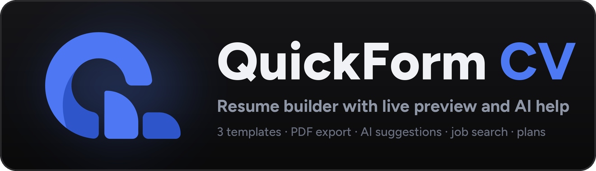
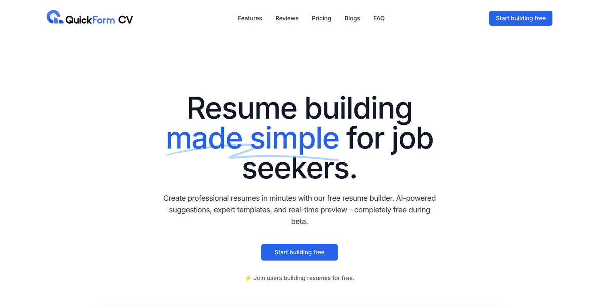
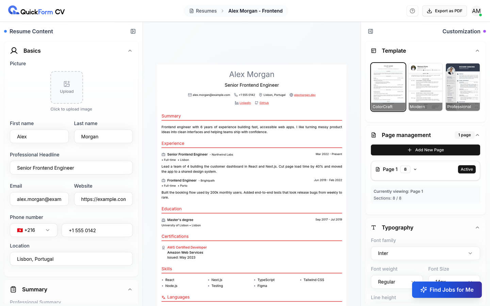
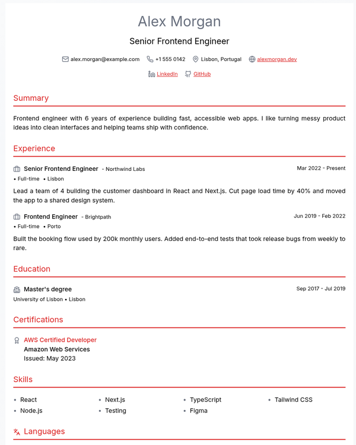
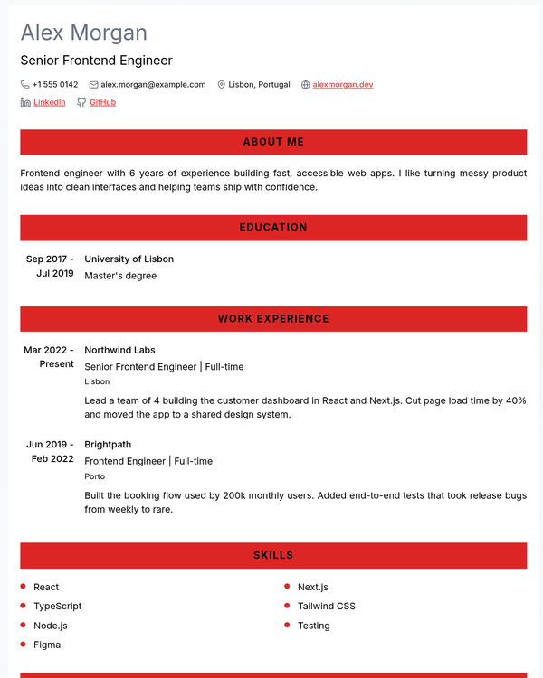
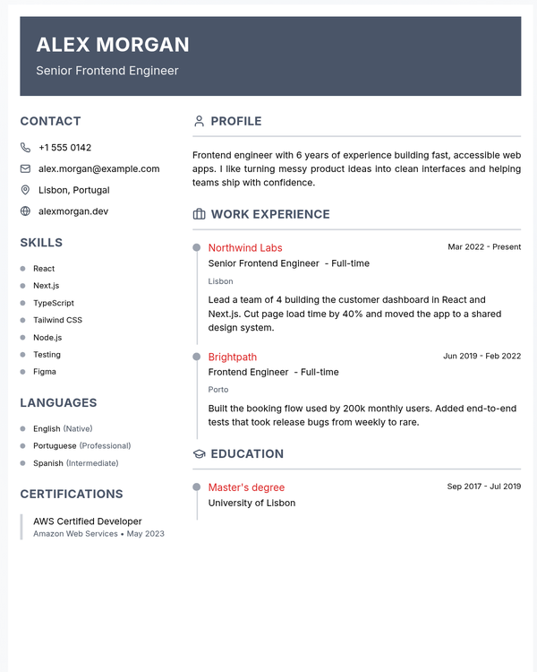
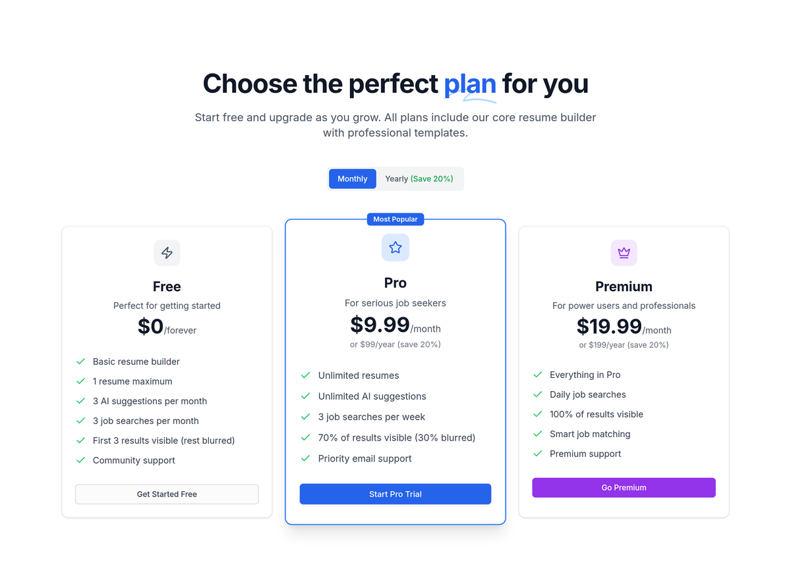

<p align="center">
  
</p>

<p align="center">
  
  
  
  
  
  <a href="LICENSE"></a>
</p>

<p align="center">
  <b>Fill in a form, watch your resume take shape, export a clean PDF.</b><br>
  Three templates, live preview, AI writing help and job suggestions based on your resume.
</p>

> **Archived side project.** QuickForm CV ran in production in 2025 as a solo
> project. The live site is offline now and the code is no longer maintained,
> but everything here still builds and runs locally with Docker.

<p align="center">
  
</p>

## What it does

<p align="center">
  
</p>

- **Live builder.** Edit your details on the left and the resume updates as you
  type. Everything saves on its own.
- **Three templates.** Switch between ColorCraft, Modern and Professional at
  any time; your content stays the same.
- **Make it yours.** Accent colour, 12 fonts, weight, size, line height,
  margins, and several pages with the sections you choose on each.
- **One-click PDF.** A headless Chromium prints the exact preview, so the PDF
  matches what you see.
- **AI help.** Suggestions for your summary and your experience descriptions,
  from Llama 3.1 on Groq.
- **Job search.** The AI turns your resume into search queries and pulls
  matching jobs posted in the last few days.

## Templates

<table align="center">
  <tr>
    <td align="center" valign="top"><br><sub><b>ColorCraft</b> · centred, single column</sub></td>
    <td align="center" valign="top"><br><sub><b>Modern</b> · bold section bars</sub></td>
    <td align="center" valign="top"><br><sub><b>Professional</b> · sidebar and timeline</sub></td>
  </tr>
</table>

## Features

### Building the resume
- Sections for basics, summary, experience, education, skills, certifications,
  languages and social links
- **Drag and drop** to reorder entries, and **hide** an entry without deleting it
- Profile picture upload (stored on Cloudinary)
- Multiple pages: add a page and choose which sections go on it; the builder
  warns you about sections that aren't on any page
- A guided tour the first time you open the builder

### Plans and limits



Free, Pro and Premium tiers, with limits checked on the server: how many
resumes you can keep, AI suggestions per month and job searches per month.
When you hit a limit, the app offers an upgrade.

There is no payment provider wired in. Upgrading switches the plan directly,
which was enough to test the limits.

<br clear="right">

### Accounts
- Sign up with email and password, or with **Google**
- JWT access and refresh tokens, with the refresh token revocable on logout
- Settings page with your plan and usage

### Landing page and blog
- Landing page with features, reviews, pricing and FAQ
- A blog of resume-writing guides (ATS-friendly templates, summaries, action
  verbs), for search traffic
- Google Analytics events on the main buttons and the builder

<sub>Screenshots use made-up demo data.</sub>

## How it's built

```
Next.js 15 (React 19, Tailwind, shadcn/ui, TanStack Query, dnd-kit)
   │  REST + JWT
   ▼
FastAPI (SQLAlchemy, Pydantic) ──► PostgreSQL 15
   │
   ├─► Groq (Llama 3.1 8B): AI suggestions, job search queries
   ├─► JSearch on RapidAPI: job listings
   ├─► Cloudinary: profile pictures
   └─► Google OAuth: sign-in
```

- Each resume is stored as its basics, a list of typed sections and a metadata
  object (template, theme, typography, pages), so a template only decides how
  that data looks.
- The PDF comes from a Next.js API route that opens the resume's print view in
  Puppeteer and calls `page.pdf()`.
- Plan limits live in one place (`SubscriptionService`) and every AI or job
  call goes through it.

## Running it locally

You need Docker. Copy the example settings and start everything:

```bash
cp .env.example .env
docker compose up --build
```

- App: http://localhost:3000
- API: http://localhost:8000

The builder, the templates and email sign-up work with the placeholder values.
For the rest, put your own keys in `.env`:

| Feature | Setting |
|---|---|
| AI suggestions, job search queries | `GROQ_API_KEY` |
| Job listings | `RAPIDAPI_KEY` (JSearch) |
| Profile pictures | `CLOUDINARY_*` |
| Sign in with Google | `GOOGLE_CLIENT_ID`, `GOOGLE_CLIENT_SECRET` |

The database tables are created when the backend starts.

### Without Docker

```bash
# backend (needs a running PostgreSQL; set POSTGRES_* in quickformcv-backend/.env)
cd quickformcv-backend
pip install -r requirements.txt
uvicorn app.main:app --reload

# frontend
cd quickformcv-frontend
cp .env.example .env.local
pnpm install
pnpm dev
```

## Project layout

```
quickformcv-frontend/
  app/builder/      the builder: sidebars, templates, PDF export
  app/(dashboard)/  your resumes
  app/api/export/   PDF route (Puppeteer)
  components/       landing page, shared UI, dialogs
  hooks/ services/  data fetching and API calls
quickformcv-backend/app/
  api/endpoints/    auth, users, resumes, AI suggestions, jobs, subscriptions
  services/         resume logic, Groq, job search, plan limits
  models/ schemas/  SQLAlchemy models and Pydantic schemas
docker-compose.yml  database, backend and frontend
```

## Licence

[MIT](LICENSE)
